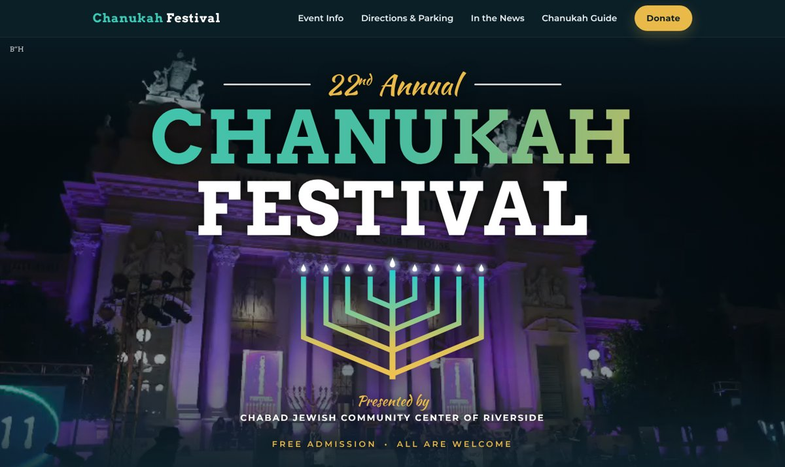
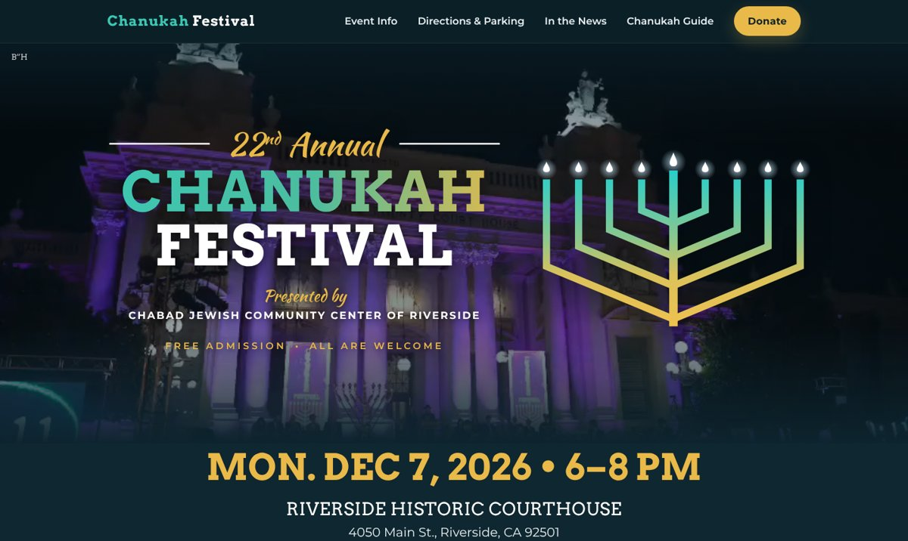
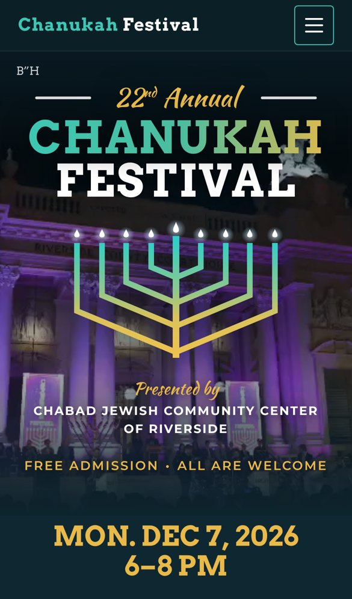
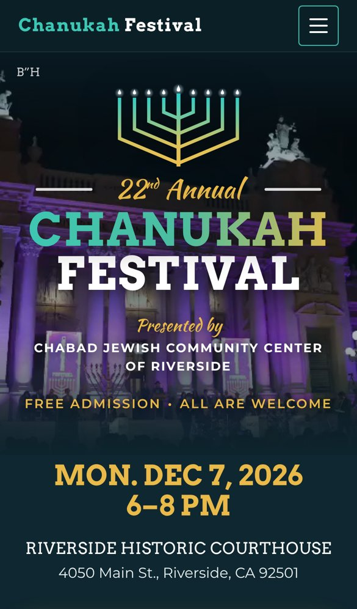
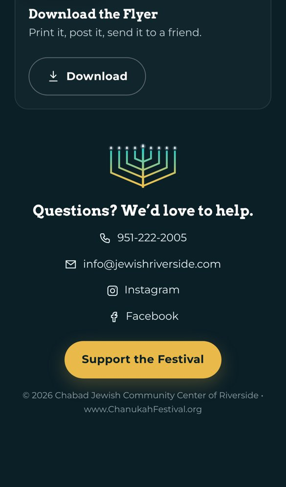
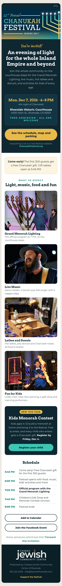
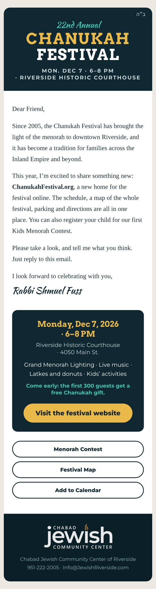

# Festival menorah on the website, and Monday's email (Nov 6, 2026)

Notes from Rabbi Shmuel Fuss's working session on the Chanukah Festival 2026 site, saved for Yudell.

## 1. Rabbi Fuss's question

> A big part of our Chanukah Festival branding is the menorah. It's the center of the flyer, the poster, the postcard and the social media images. I don't see it anywhere on the webpage, except fading in and out of the background video and on a screen behind the fire juggler photo. Can it be incorporated somewhere? It would be really cool at the top, but it's very big. Or at the bottom, to the left of the phone number and email? Or is it not relevant?

## 2. Answer

Yes, it belongs on the page. It's the festival's logo. People recognize the festival by it, and a site without it feels like a different event.

1. **Top of the page, the big one.** Two ways to do it, shown below.
2. **A small menorah mark** next to "Chanukah Festival" in the top menu bar, the way a logo sits in a site header.
3. **Footer:** a small menorah above the contact lines. The footer is centered, so above works better than to the left of the phone number, which would sit off-balance on phones.

Skip using it as a decorative divider between sections. Repeating it too often weakens it.

The menorah in the mockups is the 2026 flyer's menorah rebuilt as a vector (nine branches, raised shamash, teal-to-gold gradient, glowing flames). The file is `festival-menorah.svg` on the `chanukah-2026-brief` branch. It is not used on the page yet.

### Option B: flyer style (recommended)

The menorah sits under "CHANUKAH FESTIVAL," exactly like the flyer and poster. The same look on computers and phones, and the date still shows on a phone's first screen.

### Option A: postcard style

The menorah sits beside the title on computers, like the postcard and share image. On phones it has to move above the title, so the look differs between devices.

### On a phone, and the footer mark

| Option B, phone | Option A, phone | Footer mark |
| --- | --- | --- |
|  |  |  |

**Status:** waiting on Rabbi Fuss to pick A or B. Then: build it into the hero, the menu bar and the footer, refresh the team preview, and redo the social slides.

## 3. Monday's festival email (sent in the same reply)

Last year's email (Dec 8, 2025) was the flyer as one big image plus two image buttons (Volunteer, Support Festival). Many phones and Outlook hide images until you tap, so many people saw a mostly empty email. It had no schedule and no Add to Calendar.

Two samples, all real text so they show even with images off, in the new site's colors and fonts, with B"H in the corner:

- **Sample A, "Invitation":** the festival image, a date card, one gold button to the website, the "come early" gift, four photo highlights, the new Menorah Contest with a Register button, the schedule, Add to Calendar and the Facebook event.
- **Sample B, "Personal letter":** a short note from Rabbi Fuss introducing ChanukahFestival.org, one event card and three quick buttons.

Suggestion: send B on Monday to introduce the new site, then A a week later as the full invitation. Both point to ChanukahFestival.org, so if the page isn't live by Monday, the links switch to the festival page on JewishRiverside.com.

| Sample A, invitation | Sample B, personal letter |
| --- | --- |
|  |  |

## 4. Community invitation series (next month)

Rabbi Fuss asked for a series of messages over the next month. They tell the regulars that they are the hosts, ask everyone to bring friends and family (Jewish and non-Jewish), and recruit volunteers while thanking those who signed up.

What goes in each email:
- One main button to the website.
- Three sharing actions that work inside email: Join the Facebook Event (tap Going, then Invite), Share on WhatsApp (pre-written message), and Forward.
- A small Volunteer line and Add to Calendar.
- Copy link, Instagram and the phone share sheet stay on the website, because they don't work reliably inside email apps.

Schedule:

| Date | Send |
| --- | --- |
| Mon. Nov 9 | Personal letter (sample B): introduce the new website |
| Fri. Nov 13 | Newsletter: "You're the hosts" |
| Fri. Nov 20 | Newsletter: thank volunteers, recruit more |
| Fri. Nov 27 | Newsletter: "Bring someone new," share on social; contest closes Dec 4 |
| Mon. Nov 30 | Full invitation (sample A) |
| Fri. Dec 4 | Newsletter: Chanukah starts tonight, festival Monday |
| Sun. Dec 6 | "Tomorrow!" |
| Mon. Dec 7, morning | "Tonight!" |

The full drafts of every message and the matching social posts are in a Claude doc. Rabbi Fuss can share it with you.

**Open items for the site:** the volunteer sign-up link to use in these emails (the festival site's Volunteer page, or the mailing-list form's "Volunteering" checkbox), plus Stripe and analytics as emailed earlier today.
